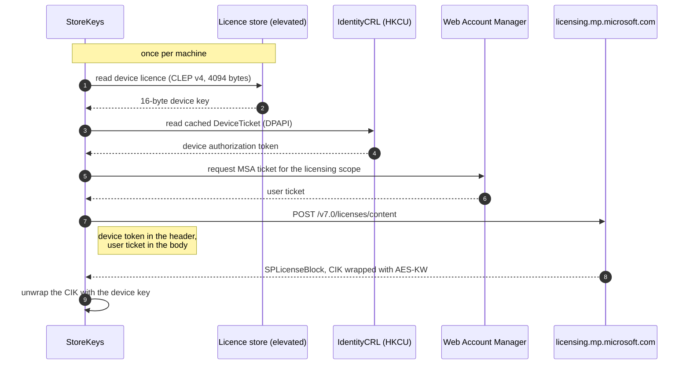

# How this works

The reverse-engineering record behind StoreKeys. None of this is needed to *use* the tool; see
the [README](../README.md) for that.

## How the key reaches your machine



Two separate secrets, and it matters which is which:

* The **device key** is 16 bytes, per-machine and effectively permanent. Deriving it reads the
  licence store out of the registry, which is the UAC prompt and the one part that genuinely
  requires your PC.
* The **content licence** carrying the CIK is per-title and issued on demand, at *licence
  acquisition* time rather than install time. That is why a key is available for anything your
  account is entitled to, installed or not.

If you have used a CikExtractor *release zip*, note those shipped an `Emulation/` folder running
`clipsp.sys` under Qiling and needed Python. Current CikExtractor reduces the CLEP v4 vault to a
closed-form computation (XOR a few words out of the encrypted key schedule, then AES-ECB), so
`LibCikExtractor` needs no Python. Only the device licence blob is used; the SMBIOS and drive
serial it collects are not fed into the derivation.

## The licensing endpoint

`C:\Windows\System32\LicenseManager.dll` performs the HTTP calls (`ClipSVC.dll` only does crypto
and storage). Strings recovered from it:

| Item | Value |
| --- | --- |
| Base | `https://licensing.mp.microsoft.com` |
| Content license | `POST /v7.0/licenses/content` |
| User root | `POST /v7.0/licenses/userRoot` |
| Subscription roots | `POST /v7.0/licenses/subscriptionRoots` |
| Lease renew / remove | `POST /v7.0/licenses/leases/{renew,remove}` |
| MSA client id | `268761a2-03f3-40df-8a8b-c3db24145b6b` |
| Scope | `service::licensing.mp.microsoft.com::MBI_SSL` |

LukeFZ describes the same endpoint in
[CikExtractor issue #4](https://github.com/LukeFZ/CikExtractor/issues/4).

### The actual contract

Several things inferred from those strings turned out to be wrong. Captured from a successful
(HTTP 200) Xbox GamingServices request:

| Field | Inferred | Actual |
| --- | --- | --- |
| `Authorization` | `WLID1.0="<user ticket>"` | `t=<device authorization token>` |
| `from` | - | `XboxLicenseManager` |
| `User-Agent` | `Microsoft-WNS/10.0` | `XboxLm-PC/Microsoft.GamingServices_…` |
| `licenseVersion` | 7 | 4 |
| `keyOnly` | - | `true` |
| `deviceContext` | 7 fields | 3 fields, all the literal string `"Public"` |
| `users` key | `"1"` | the user's Windows SID |
| `clientChallenge` | optional | **mandatory**, 504 chars base64 (static XML) |

The header and body carry *different* identities: the header authenticates the **device**, the
body the **user** via `identityValue`.

The `users` map key and `localTicketReference` look like identity but are not. The OS sends the
Windows SID and the broker's account id, but the service accepts any value and does not require
the two to match: a SID, `"1"`, and two mismatched arbitrary strings all return the same licence.
They are local handles for correlating a request that carries several identities. Only
`identityValue` authenticates.

`users` is the awkward one, pinned down by the service's own validation errors. It is a
`UserContractV7Dictionary`: a map of ticket reference to a **list** of `IdentityContractV7`. An
array at `users` is rejected ("requires a JSON object"); a bare object at `users["1"]` is
rejected ("requires a JSON array").

```json
"users": {
  "1": [
    { "identityType": "Msa", "identityValue": "<ticket>", "localTicketReference": "1" }
  ]
}
```

Response:

```
license.keys[0].metadata.drmType = "Mkms"
license.keys[0].metadata.keyId   = <guid>
license.keys[0].value            = base64 SPLicenseBlock   <- the wrapped CIK
license.leases[0].value          = base64 lease
```

### Auth goes through WAM, not public OAuth

The client id is a GUID, so `login.live.com/oauth20_authorize.srf` hands it to the converged AAD
stack, which rejects it with `unauthorized_client`. It is a first-party broker-only app, and
LicenseManager.dll uses it through the Web Account Manager: the binary references
`WebTokenRequest`, `WebTokenRequestStatus`, the `ssoappgroup`/`resource`/`authority` properties
and the MSA provider pair `https://login.microsoft.com` + `consumers`.

WAM also mints the ticket for *this* device, which is the device whose device key you hold.

## The Device Authorization token

The Authorization header needs a *device* ticket. Send a user ticket and the service answers
faultcode 4000 `InvalidDeviceAuthorizationToken`. Both are MSA compact tokens differing only in
size and type flags (`EwB4BV8i` vs `EwA4BF8i`), which makes the mistake easy to miss.

We cannot mint one: WAM was swept exhaustively (every client id in LicenseManager.dll, twelve
scope policies, eight request properties, explicit broker accounts, MSIX package identity with
`storeLicenseManagement`) and every combination returns a user ticket.

We do not need to. Windows already caches device tickets in the current user's own store, keyed
per client, located via [yegors/deGDID](https://github.com/yegors/deGDID):

```
HKCU\SOFTWARE\Microsoft\IdentityCRL\Immersive\production\Token\<client-or-package-sid>
    DeviceTicket   REG_BINARY   <DPAPI blob>
    DeviceId       REG_SZ       <16 hex chars>
```

Reading one takes three steps, each with a trap:

1. **Find the DPAPI blob.** These values carry a leading dword, so the blob starts at offset 4,
   not 0. Sniffing for the provider GUID at the wrong offset makes every entry look like it is
   not DPAPI at all.
2. **Decrypt** with `CryptUnprotectData`, CurrentUser scope. No entropy.
3. **Extract the ticket.** The plaintext is a structure, not a bare string. The ticket is a long
   printable run inside it and keeps its `t=` prefix, which must be stripped.

**Which ticket is discovered, not configured.** Tickets are scoped per relying party and the key
name does not tell you which: both package SIDs hardcoded in LicenseManager.dll are rejected, as
is the dcat client WUTokenHelper uses. So nothing is hardcoded. The tool reads every ticket,
orders them by shape alone, and moves to the next on `InvalidDeviceAuthorizationToken`. Any other
fault stops the loop, since that means the request is wrong rather than the ticket.

**Expiry is handled by re-reading.** Measured, not assumed: a token that returned HTTP 200
returned 401 a few hours later. A ticket that dies in hours cannot be a setup step, so the tool
re-reads the registry every run and a stale one falls through to a fresh one.

## ContentId

The `contentId` the service wants is the **VDUID at offset 0x220 of the XVD header**, not a Store
product id. Retail Minecraft Bedrock, for example, resolves to
`7792d9ce-355a-493c-afbd-768f4a77c3b0`. Because it sits in the first 4 KB it can be read over an
HTTP range request without downloading the package.

The `.cik` filename is a different value: the XVC **Encryption Key GUID**, which lives further
into the file in the XvcInfo region.

## Verification

* ContentId read from the 2 GB retail Minecraft `.msixvc` matches its published content id.
* SPLicenseBlock parsing, the `PackedContentKeys` walk (`keyIdSize` 0x20, `keyEntrySize` 0x28,
  two GUIDs then a 40-byte wrapped key) and RFC 3394 unwrap under the device key.
* Fetching Minecraft Bedrock's licence from the service and unwrapping it gives `bdb9e791-…` /
  `C9A969FB…6857391F`, **byte-identical** to the `.cik` CikExtractor dumps from the local
  registry. The key came off the wire, not out of the hive.
* Minecraft Preview checks out too, including the second key id, which matches
  "Encryption Key 1 GUID" in the XVD header.
* **Descenders**, owned but never installed on this machine, was fetched entirely from the
  service with nothing imported.

## Dead ends

**`DeviceEkbRequired`.** With a valid ticket and a well-formed body the service replied
`{"faultcode":3023,"code":"DeviceEkbRequired"}`, which reads as a missing device identity. The
producer looked like `ClipGenerateClientChallengeData` in `clipc.dll` (RVA `0x4160`), and
[research on the CLIP service](https://github.com/KiFilterFiberContext/windows-software-policy)
shows ClipSVC's handler structures are WarBird-obfuscated, so reversing it looked expensive.

None of that was needed. `DeviceEkbRequired` is simply what the service says when
`clientChallenge` is missing *or malformed*, which is what made it read as a device-binding
problem rather than a serialisation one. Base64-decoding the field gives 377 bytes of plain XML
declaring three protocol versions, with no device binding:

```xml
<ClientChallenge ... Version="2">
  <LicenseProtocolVersion>5</LicenseProtocolVersion>
  <SigningKeyVersion>1</SigningKeyVersion>
  <ClientVersion>2</ClientVersion>
</ClientChallenge>
```

It was byte-identical across captures because it is a constant, not because it is machine-bound.
`ClientChallenge.Build()` reproduces it exactly.

**Xbox console licences.** `XvdTool.Streaming` also understands Xbox CLAS licences (namespace
`…/xboxlive/security/clas/LicResp/v1`, a base64 `SignedLicense` wrapping an `SPLicenseBlock`)
whose CIK is AES-ECB encrypted under the **ODK**, not the device key. That needs a console secret
and is out of scope. Xbox titles installed through the Xbox app on PC use the normal
ClipSVC/device-key path and work here.

## Why StoreLib is a submodule

Not the NuGet package: the published 1.2.1 predates MSA token support, and without a Windows
Update ticket the delivery service strips every file entry for paid content. The token-capable
code only ever existed on the `Public` branch and the repo is archived, so the pin is stable.
Only `FetchPackagesAsync` needs it; the CIK path uses DisplayCatalog only.

## What is written here, and why it has to be

* `LicensingClient` / `ClientChallenge` - the licensing protocol is undocumented and no library
  implements it.
* `DeviceTokenStore`, `WamAuth` - Windows APIs, called directly.
* `XvcHeader` - only reads the VDUID at 0x220. LibXboxOne has a full `XvdHeader` struct but it
  wants the whole header; reading 16 bytes works the same over a local file and an HTTP range
  request, which is the point.
